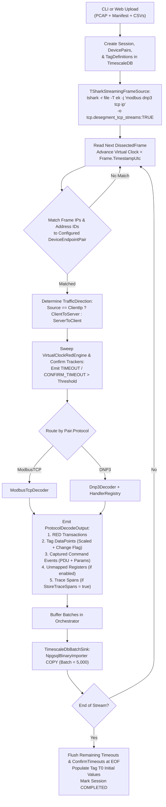
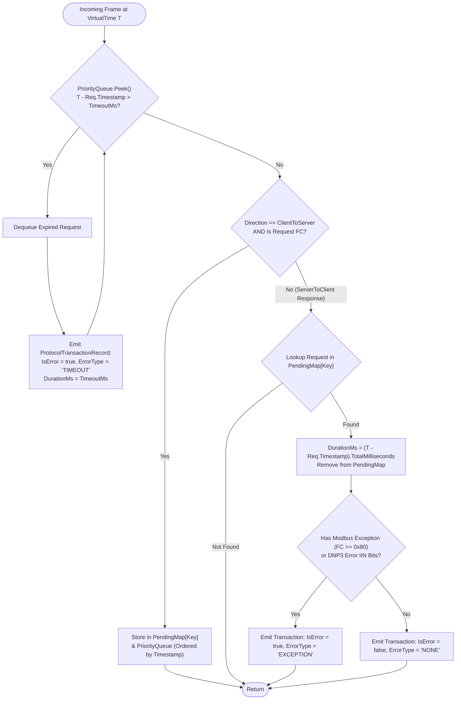
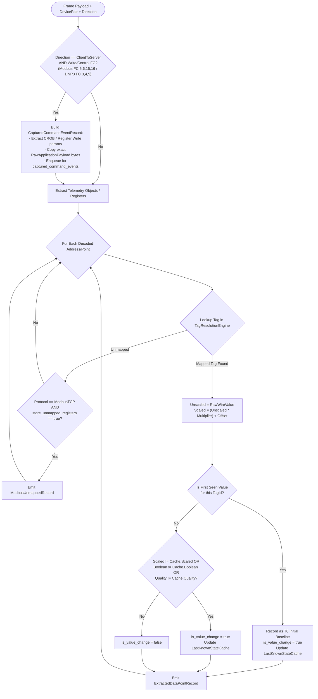

# MASTER ENGINEERING SPECIFICATION: Industrial Protocol Traffic Analyzer (FAT/SAT)

## 1. Project Purpose & High-Level Objectives
This application ingests Wireshark PCAP/PCAPNG captures of industrial network traffic (**Modbus TCP** and **DNP3**) to verify system performance during Factory Acceptance Testing (FAT) and Site Acceptance Testing (SAT).

### Core Capabilities
1. **PCAP Ingestion & Dissection:** Stream-process captures up to ~500 MB using a `tshark`-backed NDJSON streaming adapter with TCP stream desegmentation enabled.
2. **Protocol Decoding & Extensibility:**
   - **Modbus TCP:** Decode requests, responses, exceptions, and register payloads.
   - **DNP3:** Decode application headers, Internal Indications (IIN), and Object Groups/Variations using an extensible handler registry designed to scale to full **SEL RTAC** object support.
3. **Multi-Device Tag Resolution:** Map raw protocol addresses to human-readable engineering tags via CSV imports scoped to specific **Client/Server Device Pairs**, applying linear scaling ($y = mx + c$).
4. **Virtual-Clock RED Metrics:** Calculate Request **R**ate, **E**rrors (including configurable request timeouts and protocol exceptions), and **D**uration (response latency) using PCAP packet timestamps rather than wall-clock time.
5. **Time-Series & State Change Tracking:** Store both unscaled wire values and scaled engineering values, dual timestamps (PCAP arrival time vs. DNP3 internal RTU event time), quality flags, and state transition flags (`is_value_change`).
6. **Replay Readiness:** Capture frame sequencing, packet directionality, initial $T_0$ tag states, and raw/structured control commands (`captured_command_events`) so an adjacent Replay Service can perform either **Server Replay** (responding to external polls) or **Client Replay** (replaying captured control commands).
7. **Storage & Visualization:** Persist structured datasets in **TimescaleDB (PostgreSQL)** and archive raw PCAPs in **S3/MinIO**, enabling read-only analytics in **Grafana**.
8. **Trace Spans & Topology Visualization:** Emit deterministic W3C/OpenTelemetry-compatible trace spans (`trace_spans`) with cross-table correlation (`trace_id`/`span_id` on `red_transactions`, `captured_command_events`, and `tag_values`), multi-step DNP3 Select-Before-Operate (SBO) and Application Confirm (`CON = 1`) hierarchies, and PostgreSQL helper views (`v_grafana_traces`, `v_grafana_node_graph_nodes`, `v_grafana_node_graph_edges`) powering Grafana Traces waterfalls and Node Graph topology maps.

---

## 2. Non-Negotiable Architectural & Coding Rules (For AI Agents)

1. **Priority Order:** Maintainability, Observability, Testability, and Extensibility take strict precedence over micro-optimizations.
2. **Clean / Hexagonal Architecture:**
   - `Analyzer.Core` must have **zero dependencies** on database drivers (`Npgsql`), external processes (`tshark`), or UI frameworks.
   - Protocol decoders must be pure, stateless/scoped domain services that accept dissected frames/byte payloads and emit strongly typed domain records.
3. **Unit Testability Without External Binaries:**
   - Unit tests must **never** invoke `tshark` or require a live database.
   - Ingestion is abstracted behind `IFrameSource`. Tests inject synthetic `DissectedFrame` streams or static NDJSON fixtures.
4. **Virtual Clock Enforcement:**
   - Never use `DateTime.Now` or `DateTime.UtcNow` when evaluating packet timeouts or transaction durations. All timing calculations must be driven exclusively by `DissectedFrame.TimestampUtc`.
5. **Cross-Platform Target:**
   - Target **.NET 8.0 (or .NET 9.0)** in C#. Code must compile and run identically on **Windows (`win-x64`)** and **Linux (`linux-x64`)**.
   - Must support deployment via **Docker Compose** and as a **Standalone Single-File Executable** (`PublishSingleFile=true`).
6. **Strong Domain Typing (Enums & Value Objects over Free-Form Primitives):**
   - Model finite sets of values (e.g., protocol identifiers, tag data types, error classifications, transaction status codes) using C# `enum` types or strongly typed value objects rather than free-form `string` or unconstrained primitive fields. Parse external strings into strong domain types at the ingestion/configuration seam and serialize to wire/database strings only at the persistence seam.

---

## 3. Solution & Directory Structure

```text
ProtocolAnalyzer/
├── AGENTS.md                                 # Agent guidelines & architecture rules
├── GLOSSARY.md                               # Canonical domain terminology
├── SPECIFICATION.md                          # Master engineering specification
├── docker-compose.yml                        # TimescaleDB, pgAdmin, MinIO, Grafana
├── docker/
│   ├── grafana/
│   │   ├── dashboards/
│   │   │   ├── industrial_protocol_analyzer.json   # Main FAT/SAT RED, telemetry & command dashboard
│   │   │   └── trace_topology_explorer.json        # Trace waterfall & Node Graph topology dashboard
│   │   └── provisioning/                     # Grafana datasource & dashboard YAML provisioning
│   └── sql/
│       ├── 001_init_timescaledb.sql          # Base DDL schema & delete_test_session function
│       └── 002_add_trace_spans.sql           # Idempotent trace_spans hypertable, correlation columns & Grafana views
├── docs/
│   └── adr/                                  # Architecture Decision Records (0001, 0002)
├── src/
│   ├── Analyzer.Core/                        # Pure Domain Models, Interfaces, Pipeline Orchestrator
│   │   ├── Domain/                           # DomainRecords.cs, TraceDomain.cs (TraceId, SpanId, enums/records)
│   │   ├── Interfaces/                       # IFrameSource, IProtocolDecoder, IDnp3ObjectGroupHandler, IDataSink, IPcapArchiveStorage
│   │   ├── Services/                         # VirtualClockRedEngine, TagResolutionEngine, DeterministicTraceIdGenerator
│   │   └── Pipeline/                         # IngestionPipelineOrchestrator
│   ├── Analyzer.Decoders.Modbus/             # Modbus TCP Decoder, Register Extractors & Span Factory
│   ├── Analyzer.Decoders.Dnp3/               # DNP3 Decoder, Handler Registry, SBO/Confirm Trackers & Span Factory
│   │   ├── Handlers/                         # IDnp3ObjectGroupHandler implementations (G1, G2, G10, G12, G20, G22, G30, G32)
│   │   └── Registry/                         # Dnp3HandlerRegistry
│   ├── Analyzer.Infrastructure/              # External Adapters
│   │   ├── Dissection/                       # TSharkStreamingFrameSource (NDJSON parser)
│   │   ├── Persistence/                      # TimescaleDbBatchSink (NpgsqlBinaryImporter / PersistenceWireFormat)
│   │   ├── Mapping/                          # CsvTagMappingLoader, ManifestParser, ProtocolTypeParser
│   │   └── Storage/                          # MinioPcapStorageService
│   ├── Analyzer.Cli/                         # CLI Tool (System.CommandLine)
│   └── Analyzer.Web/                         # ASP.NET Core Minimal API health/web host
└── tests/
    ├── Analyzer.Core.Tests/                  # Pipeline, Virtual Clock, TraceId/SpanId, Tag Scaling tests
    ├── Analyzer.Decoders.Modbus.Tests/       # Modbus FC decoding, exception, unmapped & trace span tests
    ├── Analyzer.Decoders.Dnp3.Tests/         # DNP3 G/V handlers, dual-timestamp, CROB, SBO & Confirm span tests
    ├── Analyzer.Infrastructure.Tests/        # CSV parser, NDJSON stream, Manifest & BatchSink COPY tests
    ├── Analyzer.Cli.Tests/                   # CLI option parsing, --no-traces & pipeline runner tests
    └── Analyzer.IntegrationTests/            # Live TimescaleDB, MinIO, tshark & Grafana SQL view/dashboard tests
```

---

## 4. Complete Database Schema (`docker/sql/001_init_timescaledb.sql`)

Native TimescaleDB chunk compression is **intentionally disabled** by default to simplify operations and allow native `ON DELETE CASCADE` execution. A `delete_test_session` stored function is provided to future-proof chunk decompression before deletion.

```sql
CREATE EXTENSION IF NOT EXISTS timescaledb;

-- ============================================================================
-- 1. TEST SESSIONS (Parent Metadata Table)
-- ============================================================================
CREATE TABLE test_sessions (
    id UUID PRIMARY KEY DEFAULT gen_random_uuid(),
    name VARCHAR(255) NOT NULL,
    pcap_file_name VARCHAR(255) NOT NULL,
    s3_object_key VARCHAR(512),
    timeout_threshold_ms INT NOT NULL DEFAULT 2000,
    store_unmapped_registers BOOLEAN NOT NULL DEFAULT FALSE,
    ingested_at TIMESTAMPTZ NOT NULL DEFAULT NOW(),
    status VARCHAR(50) NOT NULL DEFAULT 'PROCESSING' -- 'PROCESSING', 'COMPLETED', 'FAILED'
);

-- ============================================================================
-- 2. DEVICE PAIRS (Strict Client/Server Semantics)
-- ============================================================================
CREATE TABLE device_pairs (
    id UUID PRIMARY KEY DEFAULT gen_random_uuid(),
    session_id UUID NOT NULL REFERENCES test_sessions(id) ON DELETE CASCADE,
    name VARCHAR(100) NOT NULL,
    protocol VARCHAR(50) NOT NULL,            -- 'ModbusTCP', 'DNP3'
    client_ip INET NOT NULL,
    server_ip INET NOT NULL,
    client_protocol_address_id INT,           -- e.g. DNP3 Master Address (nullable for Modbus)
    server_protocol_address_id INT            -- e.g. DNP3 Outstation Address or Modbus Unit ID
);
CREATE INDEX idx_device_pairs_session ON device_pairs(session_id);

-- ============================================================================
-- 3. TAG DEFINITIONS (Includes Scaling & T0 Initial State for Server Replay)
-- ============================================================================
CREATE TABLE tag_definitions (
    id UUID PRIMARY KEY DEFAULT gen_random_uuid(),
    device_pair_id UUID NOT NULL REFERENCES device_pairs(id) ON DELETE CASCADE,
    tag_name VARCHAR(255) NOT NULL,
    protocol_address VARCHAR(100) NOT NULL,   -- e.g. 'HR:40001', 'COIL:00012', 'G30V02:Idx4'
    data_type VARCHAR(50) NOT NULL,           -- 'BOOL', 'INT16', 'UINT16', 'INT32', 'UINT32', 'INT64', 'UINT64', 'FLOAT32', 'FLOAT64'
    endianness VARCHAR(10) NOT NULL DEFAULT 'ABCD', -- 'ABCD', 'DCBA', 'BADC', 'CDAB'
    scale_multiplier DOUBLE PRECISION NOT NULL DEFAULT 1.0,
    scale_offset DOUBLE PRECISION NOT NULL DEFAULT 0.0,
    engineering_units VARCHAR(50),
    description TEXT,
    -- Initial baseline state (T0) captured from first appearance in PCAP for Server Replay:
    initial_unscaled_numeric_value DOUBLE PRECISION,
    initial_scaled_numeric_value DOUBLE PRECISION,
    initial_boolean_value BOOLEAN,
    initial_raw_hex VARCHAR(64)
);
CREATE UNIQUE INDEX idx_tag_unique ON tag_definitions(device_pair_id, protocol_address);

-- ============================================================================
-- 4. RED TRANSACTIONS (Hypertable: Rate, Errors, Duration)
-- ============================================================================
CREATE TABLE red_transactions (
    timestamp TIMESTAMPTZ NOT NULL,
    session_id UUID NOT NULL REFERENCES test_sessions(id) ON DELETE CASCADE,
    device_pair_id UUID NOT NULL REFERENCES device_pairs(id) ON DELETE CASCADE,
    frame_number BIGINT NOT NULL,
    direction VARCHAR(20) NOT NULL,           -- 'CLIENT_TO_SERVER', 'SERVER_TO_CLIENT'
    transaction_id VARCHAR(50),               -- Modbus MBAP TxID or DNP3 App Sequence
    function_code SMALLINT,
    duration_ms DOUBLE PRECISION,             -- Response Timestamp - Request Timestamp
    is_error BOOLEAN NOT NULL DEFAULT FALSE,
    error_type VARCHAR(50) NOT NULL,          -- 'NONE', 'TIMEOUT', 'TIMEOUT_AT_EOF', 'EXCEPTION', 'MALFORMED'
    status_code VARCHAR(50) NOT NULL          -- 'SUCCESS', 'MODBUS_EX_02', 'DNP3_IIN_PARAM_ERR', etc.
);
SELECT create_hypertable('red_transactions', 'timestamp', chunk_time_interval => INTERVAL '1 day');
CREATE INDEX idx_red_session_cascade ON red_transactions(session_id, timestamp DESC);
CREATE INDEX idx_red_device_pair ON red_transactions(device_pair_id, timestamp DESC);

-- ============================================================================
-- 5. TAG VALUES / TIME SERIES (Hypertable: Dual Timestamps & Dual Numerics)
-- ============================================================================
CREATE TABLE tag_values (
    packet_timestamp TIMESTAMPTZ NOT NULL,
    event_timestamp TIMESTAMPTZ,              -- DNP3 internal RTU hardware timestamp (nullable)
    session_id UUID NOT NULL REFERENCES test_sessions(id) ON DELETE CASCADE,
    tag_id UUID NOT NULL REFERENCES tag_definitions(id) ON DELETE CASCADE,
    frame_number BIGINT NOT NULL,
    direction VARCHAR(20) NOT NULL,           -- 'CLIENT_TO_SERVER', 'SERVER_TO_CLIENT'
    unscaled_numeric_value DOUBLE PRECISION,  -- Wire value before scaling
    scaled_numeric_value DOUBLE PRECISION,    -- (unscaled * scale_multiplier) + scale_offset
    boolean_value BOOLEAN,
    raw_hex VARCHAR(64) NOT NULL,
    quality_flags VARCHAR(100),               -- e.g. 'ONLINE|RESTART|COMM_LOST'
    is_value_change BOOLEAN NOT NULL DEFAULT FALSE
);
SELECT create_hypertable('tag_values', 'packet_timestamp', chunk_time_interval => INTERVAL '1 day');
CREATE INDEX idx_tag_vals_session_cascade ON tag_values(session_id, packet_timestamp DESC);
CREATE INDEX idx_tag_vals_query ON tag_values(tag_id, packet_timestamp DESC);
CREATE INDEX idx_tag_vals_changes ON tag_values(tag_id, packet_timestamp DESC) WHERE is_value_change = TRUE;

-- ============================================================================
-- 6. CAPTURED COMMAND EVENTS (Hypertable for Client Control Replay)
-- ============================================================================
CREATE TABLE captured_command_events (
    timestamp TIMESTAMPTZ NOT NULL,
    session_id UUID NOT NULL REFERENCES test_sessions(id) ON DELETE CASCADE,
    device_pair_id UUID NOT NULL REFERENCES device_pairs(id) ON DELETE CASCADE,
    frame_number BIGINT NOT NULL,
    direction VARCHAR(20) NOT NULL DEFAULT 'CLIENT_TO_SERVER',
    protocol VARCHAR(50) NOT NULL,            -- 'ModbusTCP', 'DNP3'
    function_code SMALLINT NOT NULL,
    command_type VARCHAR(50) NOT NULL,        -- 'MODBUS_WRITE_SINGLE_COIL', 'MODBUS_WRITE_MULTI_REGS', 'DNP3_CROB_SELECT', 'DNP3_CROB_OPERATE', 'DNP3_DIRECT_OPERATE'
    target_address VARCHAR(100) NOT NULL,     -- e.g. 'HR:40005', 'G12V01:Idx2'
    control_action VARCHAR(50),               -- DNP3 CROB: 'PULSE_ON', 'PULSE_OFF', 'LATCH_ON', 'LATCH_OFF', 'TRIP', 'CLOSE'
    command_count SMALLINT,                   -- DNP3 CROB count or Modbus register count
    pulse_on_ms BIGINT,                       -- DNP3 CROB On-Time
    pulse_off_ms BIGINT,                      -- DNP3 CROB Off-Time
    unscaled_command_value DOUBLE PRECISION,  -- Written numeric value (if applicable)
    raw_pdu_bytes BYTEA NOT NULL              -- Exact Application PDU bytes for wire-accurate replay
);
SELECT create_hypertable('captured_command_events', 'timestamp', chunk_time_interval => INTERVAL '1 day');
CREATE INDEX idx_cmd_events_session_seq ON captured_command_events(session_id, frame_number ASC);

-- ============================================================================
-- 7. UNMAPPED MODBUS REGISTERS (Hypertable for Diagnostics & Contiguous Replay)
-- ============================================================================
CREATE TABLE modbus_raw_unmapped (
    timestamp TIMESTAMPTZ NOT NULL,
    session_id UUID NOT NULL REFERENCES test_sessions(id) ON DELETE CASCADE,
    device_pair_id UUID NOT NULL REFERENCES device_pairs(id) ON DELETE CASCADE,
    frame_number BIGINT NOT NULL,
    direction VARCHAR(20) NOT NULL,           -- 'CLIENT_TO_SERVER', 'SERVER_TO_CLIENT'
    unit_id SMALLINT NOT NULL,
    register_type VARCHAR(20) NOT NULL,       -- 'HOLDING', 'INPUT', 'COIL', 'DISCRETE_INPUT'
    register_offset INT NOT NULL,
    raw_value_hex VARCHAR(16) NOT NULL
);
SELECT create_hypertable('modbus_raw_unmapped', 'timestamp', chunk_time_interval => INTERVAL '1 day');
CREATE INDEX idx_modbus_unmapped_session ON modbus_raw_unmapped(session_id, timestamp DESC);

-- ============================================================================
-- 8. SESSION CLEANUP FUNCTION (Future Compression Hook)
-- ============================================================================
CREATE OR REPLACE FUNCTION delete_test_session(target_session_id UUID)
RETURNS VOID AS $$
DECLARE
    r RECORD;
BEGIN
    FOR r IN 
        SELECT DISTINCT chunk_schema, chunk_name 
        FROM timescaledb_information.chunks
        WHERE is_compressed = TRUE
    LOOP
        EXECUTE format('SELECT decompress_chunk(''%I.%I'', if_compressed => true);', r.chunk_schema, r.chunk_name);
    END LOOP;

    DELETE FROM test_sessions WHERE id = target_session_id;
END;
$$ LANGUAGE plpgsql;
```

### 4.1 Incremental Migration: Trace Spans & Grafana Views (`docker/sql/002_add_trace_spans.sql`)

`docker-compose.yml` mounts `./docker/sql:/docker-entrypoint-initdb.d:ro` so fresh TimescaleDB volumes automatically apply `001_init_timescaledb.sql` followed by `002_add_trace_spans.sql`. Existing volumes can apply `002_add_trace_spans.sql` idempotently without dropping existing sessions. `delete_test_session(UUID)` cascades cleanly across `trace_spans` via `ON DELETE CASCADE`.

```sql
-- 1. test_sessions: trace toggle & DNP3 SBO correlation window
ALTER TABLE test_sessions
    ADD COLUMN IF NOT EXISTS store_trace_spans BOOLEAN NOT NULL DEFAULT TRUE,
    ADD COLUMN IF NOT EXISTS sbo_window_ms INT NOT NULL DEFAULT 10000;

-- 2. device_pairs: optional human-readable endpoint names for Trace View & Node Graph
ALTER TABLE device_pairs
    ADD COLUMN IF NOT EXISTS client_name VARCHAR(100),
    ADD COLUMN IF NOT EXISTS server_name VARCHAR(100);

-- 3. Cross-table trace/span correlation columns (nullable when store_trace_spans = FALSE or legacy sessions)
ALTER TABLE red_transactions
    ADD COLUMN IF NOT EXISTS trace_id VARCHAR(32),
    ADD COLUMN IF NOT EXISTS span_id VARCHAR(16);

ALTER TABLE captured_command_events
    ADD COLUMN IF NOT EXISTS trace_id VARCHAR(32),
    ADD COLUMN IF NOT EXISTS span_id VARCHAR(16);

ALTER TABLE tag_values
    ADD COLUMN IF NOT EXISTS trace_id VARCHAR(32),
    ADD COLUMN IF NOT EXISTS span_id VARCHAR(16);

CREATE INDEX IF NOT EXISTS idx_red_tx_trace
    ON red_transactions (session_id, trace_id)
    WHERE trace_id IS NOT NULL;

CREATE INDEX IF NOT EXISTS idx_cmd_events_trace
    ON captured_command_events (session_id, trace_id)
    WHERE trace_id IS NOT NULL;

CREATE INDEX IF NOT EXISTS idx_tag_vals_trace
    ON tag_values (session_id, trace_id)
    WHERE trace_id IS NOT NULL;

-- 4. trace_spans hypertable
CREATE TABLE IF NOT EXISTS trace_spans (
    start_time TIMESTAMPTZ NOT NULL,
    end_time TIMESTAMPTZ NOT NULL,
    duration_ms DOUBLE PRECISION NOT NULL,
    session_id UUID NOT NULL REFERENCES test_sessions(id) ON DELETE CASCADE,
    device_pair_id UUID NOT NULL REFERENCES device_pairs(id) ON DELETE CASCADE,
    trace_id VARCHAR(32) NOT NULL,               -- W3C 32 lowercase hex chars (128-bit)
    span_id VARCHAR(16) NOT NULL,                -- W3C 16 lowercase hex chars (64-bit)
    parent_span_id VARCHAR(16),                  -- Nullable; NULL for root spans
    service_name VARCHAR(128) NOT NULL,          -- Resolved server_name (or client_name for unsolicited/server-origin)
    operation_name VARCHAR(128) NOT NULL,        -- Low-cardinality operation, e.g. 'Modbus FC03 ReadHoldingRegisters'
    span_kind VARCHAR(20) NOT NULL,              -- 'CLIENT', 'SERVER', 'PRODUCER', 'CONSUMER', 'INTERNAL'
    origin_kind VARCHAR(32) NOT NULL,            -- 'REQUEST_RESPONSE', 'TIMEOUT', 'TIMEOUT_AT_EOF', 'MALFORMED',
                                                 -- 'UNSOLICITED', 'DIRECT_NO_ACK', 'CONFIRM', 'CONFIRM_TIMEOUT', 'ORPHAN_RESPONSE'
    status_code VARCHAR(16) NOT NULL,            -- 'UNSET', 'OK', 'ERROR'
    status_message VARCHAR(128),                 -- e.g. 'MODBUS_EX_02', 'TIMEOUT', 'DNP3_IIN_PARAM_ERR', 'CONFIRM_TIMEOUT'
    protocol VARCHAR(50) NOT NULL,               -- 'ModbusTCP', 'DNP3'
    client_endpoint VARCHAR(128) NOT NULL,       -- Resolved client device node identity
    server_endpoint VARCHAR(128) NOT NULL,       -- Resolved server device node identity
    direction VARCHAR(20) NOT NULL,              -- 'CLIENT_TO_SERVER', 'SERVER_TO_CLIENT'
    request_frame_number BIGINT,                 -- Nullable (e.g. OrphanResponse, Unsolicited)
    response_frame_number BIGINT,                -- Nullable (e.g. Timeout, DirectNoAck)
    transaction_id VARCHAR(50),                  -- Modbus MBAP TxID or DNP3 App Sequence
    function_code SMALLINT,                      -- Primary protocol function code
    attributes JSONB NOT NULL DEFAULT '{}'::jsonb,
    events JSONB NOT NULL DEFAULT '[]'::jsonb
);

SELECT create_hypertable(
    'trace_spans',
    'start_time',
    chunk_time_interval => INTERVAL '1 day',
    if_not_exists => TRUE
);

CREATE INDEX IF NOT EXISTS idx_trace_spans_session_time
    ON trace_spans (session_id, start_time DESC);

CREATE INDEX IF NOT EXISTS idx_trace_spans_session_trace
    ON trace_spans (session_id, trace_id, start_time ASC);

CREATE INDEX IF NOT EXISTS idx_trace_spans_session_errors
    ON trace_spans (session_id, start_time DESC)
    WHERE status_code = 'ERROR';

CREATE INDEX IF NOT EXISTS idx_trace_spans_device_pair
    ON trace_spans (device_pair_id, start_time DESC);

-- 5. Grafana Traces & Node Graph SQL Views
CREATE OR REPLACE VIEW v_grafana_traces AS
SELECT
    s.session_id,
    s.device_pair_id,
    s.start_time AS start_time_utc,
    s.origin_kind,
    s.protocol,
    s.trace_id AS "traceID",
    s.span_id AS "spanID",
    COALESCE(s.parent_span_id, '') AS "parentSpanID",
    s.operation_name AS "operationName",
    s.service_name AS "serviceName",
    (EXTRACT(EPOCH FROM s.start_time) * 1000.0)::double precision AS "startTime",
    s.duration_ms AS "duration",
    CASE s.status_code
        WHEN 'OK' THEN 1
        WHEN 'ERROR' THEN 2
        ELSE 0
    END AS "statusCode",
    COALESCE(s.status_message, '') AS "statusMessage",
    jsonb_build_array(
        jsonb_build_object('key', 'protocol', 'value', s.protocol),
        jsonb_build_object('key', 'device.pair.name', 'value', dp.name),
        jsonb_build_object('key', 'endpoint.client', 'value', s.client_endpoint),
        jsonb_build_object('key', 'endpoint.server', 'value', s.server_endpoint),
        jsonb_build_object('key', 'span.kind', 'value', s.span_kind),
        jsonb_build_object('key', 'span.origin_kind', 'value', s.origin_kind)
    ) AS "serviceTags",
    COALESCE(
        (
            SELECT jsonb_agg(jsonb_build_object('key', kv.key, 'value', kv.value) ORDER BY kv.key)
            FROM jsonb_each(s.attributes) AS kv(key, value)
        ),
        '[]'::jsonb
    ) AS "tags",
    s.events AS "logs"
FROM trace_spans s
JOIN device_pairs dp ON dp.id = s.device_pair_id;

CREATE OR REPLACE VIEW v_grafana_node_graph_nodes AS
WITH node_spans AS (
    SELECT
        s.session_id,
        ep.node_id,
        ep.node_ip,
        s.protocol,
        s.duration_ms,
        ep.is_target,
        (s.status_code = 'ERROR') AS is_error
    FROM trace_spans s
    JOIN device_pairs dp ON dp.id = s.device_pair_id
    CROSS JOIN LATERAL (
        SELECT
            s.client_endpoint AS node_id,
            host(dp.client_ip) AS node_ip,
            (s.direction = 'SERVER_TO_CLIENT' OR s.client_endpoint = s.server_endpoint) AS is_target
        UNION ALL
        SELECT
            s.server_endpoint AS node_id,
            host(dp.server_ip) AS node_ip,
            (s.direction <> 'SERVER_TO_CLIENT') AS is_target
        WHERE s.server_endpoint <> s.client_endpoint
    ) ep
)
SELECT
    session_id,
    node_id AS id,
    node_id AS title,
    string_agg(DISTINCT node_ip, ', ' ORDER BY node_ip)
        || ' (' || string_agg(DISTINCT protocol, ', ' ORDER BY protocol) || ')' AS "subTitle",
    COUNT(*)::bigint AS "mainStat",
    ROUND(COALESCE(AVG(duration_ms) FILTER (WHERE is_target), 0.0)::numeric, 2)::double precision AS "secondaryStat",
    (COUNT(*) FILTER (WHERE NOT is_error)::double precision / NULLIF(COUNT(*), 0)::double precision) AS arc__success,
    (COUNT(*) FILTER (WHERE is_error)::double precision / NULLIF(COUNT(*), 0)::double precision) AS arc__error
FROM node_spans
GROUP BY session_id, node_id;

CREATE OR REPLACE VIEW v_grafana_node_graph_edges AS
WITH directed_spans AS (
    SELECT
        s.session_id,
        CASE
            WHEN s.direction = 'SERVER_TO_CLIENT' THEN s.server_endpoint
            ELSE s.client_endpoint
        END AS source,
        CASE
            WHEN s.direction = 'SERVER_TO_CLIENT' THEN s.client_endpoint
            ELSE s.server_endpoint
        END AS target,
        s.protocol,
        s.duration_ms,
        (s.status_code = 'ERROR') AS is_error
    FROM trace_spans s
),
edge_stats AS (
    SELECT
        session_id,
        source,
        target,
        protocol,
        COUNT(*)::bigint AS span_count,
        COUNT(*) FILTER (WHERE is_error)::bigint AS error_count,
        ROUND(AVG(duration_ms)::numeric, 2)::double precision AS avg_duration_ms,
        ROUND((percentile_cont(0.95) WITHIN GROUP (ORDER BY duration_ms))::numeric, 2)::double precision AS p95_duration_ms
    FROM directed_spans
    GROUP BY session_id, source, target, protocol
)
SELECT
    session_id,
    source || '->' || target || ':' || protocol AS id,
    source,
    target,
    span_count::text || ' spans / ' || ROUND(avg_duration_ms::numeric, 2)::text || ' ms' AS "mainStat",
    ROUND((error_count * 100.0 / NULLIF(span_count, 0))::numeric, 1)::text || '% err (' || protocol || ')' AS "secondaryStat",
    protocol AS detail__protocol,
    span_count AS detail__span_count,
    error_count AS detail__error_count,
    avg_duration_ms AS detail__avg_duration_ms,
    p95_duration_ms AS detail__p95_duration_ms
FROM edge_stats;
```

---

## 5. Core C# Domain & Interface Contracts (`Analyzer.Core`)

Coding agents must implement these exact contracts in `Analyzer.Core`:

```csharp
namespace Analyzer.Core.Domain;

public enum TrafficDirection
{
    ClientToServer,
    ServerToClient
}

public enum ProtocolType
{
    ModbusTcp,
    Dnp3
}

public enum SessionStatus
{
    Processing,
    Completed,
    Failed
}

public enum TagDataType
{
    Bool,
    Int16,
    UInt16,
    Int32,
    UInt32,
    Int64,
    UInt64,
    Float32,
    Float64
}

public enum RegisterEndianness
{
    Abcd,
    Dcba,
    Badc,
    Cdab
}

public enum TransactionErrorType
{
    None,
    Timeout,
    TimeoutAtEof,
    Exception,
    Malformed
}

public enum TransactionStatusCode
{
    Success,
    Timeout,
    TimeoutAtEof,
    Malformed,
    ModbusEx01,
    ModbusEx02,
    ModbusEx03,
    ModbusEx04,
    ModbusEx05,
    ModbusEx06,
    ModbusEx08,
    ModbusEx0A,
    ModbusEx0B,
    ModbusExceptionUnknown,
    Dnp3IinFuncNotSupported,
    Dnp3IinObjectUnknown,
    Dnp3IinParamErr,
    Dnp3IinEventBufferOverflow,
    Dnp3IinAlreadyExecuting,
    Dnp3IinConfigCorrupt
}

[Flags]
public enum PointQualityFlags
{
    None = 0,
    Online = 1 << 0,
    Restart = 1 << 1,
    CommLost = 1 << 2,
    RemoteForced = 1 << 3,
    LocalForced = 1 << 4,
    ChatterFilter = 1 << 5,
    OverRange = 1 << 6,
    ReferenceErr = 1 << 7
}

public enum CommandType
{
    ModbusWriteSingleCoil,
    ModbusWriteSingleReg,
    ModbusWriteMultiCoils,
    ModbusWriteMultiRegs,
    Dnp3CrobSelect,
    Dnp3CrobOperate,
    Dnp3DirectOperate
}

public enum Dnp3ControlAction
{
    PulseOn,
    PulseOff,
    LatchOn,
    LatchOff,
    Trip,
    Close
}

public enum ModbusRegisterType
{
    Holding,
    Input,
    Coil,
    DiscreteInput
}

public readonly struct ProtocolAddress : IEquatable<ProtocolAddress>
{
    public string Value { get; }
    public ProtocolAddress(string value) { /* validates '<Prefix>:<Target>' format */ Value = value.Trim(); }
    public static ProtocolAddress Parse(string value) => new(value);
    public static bool TryParse(string? value, out ProtocolAddress result) { /* ... */ }
}

public record TestSession(
    Guid Id,
    string Name,
    string PcapFileName,
    string? S3ObjectKey,
    int TimeoutThresholdMs = 2000,
    bool StoreUnmappedRegisters = false,
    bool StoreTraceSpans = true,
    int SboWindowMs = 10000
);

public record DeviceEndpointPair(
    Guid Id,
    Guid SessionId,
    string Name,
    ProtocolType Protocol,
    IPAddress ClientIp,
    IPAddress ServerIp,
    int? ClientProtocolAddressId,
    int? ServerProtocolAddressId,
    string? ClientName = null,
    string? ServerName = null
)
{
    public string ResolveClientEndpoint() => /* trimmed ClientName, else IP:ProtocolAddressId, else IP */;
    public string ResolveServerEndpoint() => /* trimmed ServerName, else IP:ProtocolAddressId, else IP */;
}

public record TagDefinition(
    Guid Id,
    Guid DevicePairId,
    string TagName,
    ProtocolAddress ProtocolAddress,
    TagDataType DataType,
    double ScaleMultiplier,
    double ScaleOffset,
    string? EngineeringUnits,
    string? Description,
    RegisterEndianness Endianness = RegisterEndianness.Abcd
)
{
    public double ComputeScaledValue(double unscaledValue) => (unscaledValue * ScaleMultiplier) + ScaleOffset;
}

public record DissectedFrame(
    long FrameNumber,
    DateTime TimestampUtc,
    IPAddress SourceIp,
    int SourcePort,
    IPAddress DestIp,
    int DestPort,
    ProtocolType ProtocolName,
    byte[] RawApplicationPayload,
    IReadOnlyDictionary<string, string>? DissectedFields = null
);

public record ProtocolTransactionRecord(
    DateTime Timestamp,
    Guid SessionId,
    Guid DevicePairId,
    long FrameNumber,
    TrafficDirection Direction,
    string TransactionId,
    short FunctionCode,
    double? DurationMs,
    bool IsError,
    TransactionErrorType ErrorType,
    TransactionStatusCode StatusCode,
    TraceId? TraceId = null,
    SpanId? SpanId = null
);

public record ExtractedDataPointRecord(
    DateTime PacketTimestamp,
    DateTime? EventTimestamp,
    Guid SessionId,
    Guid TagId,
    long FrameNumber,
    TrafficDirection Direction,
    double? UnscaledNumericValue,
    double? ScaledNumericValue,
    bool? BooleanValue,
    string RawHex,
    PointQualityFlags QualityFlags,
    bool IsValueChange,
    TraceId? TraceId = null,
    SpanId? SpanId = null
);

public record CapturedCommandEventRecord(
    DateTime Timestamp,
    Guid SessionId,
    Guid DevicePairId,
    long FrameNumber,
    TrafficDirection Direction,
    ProtocolType Protocol,
    short FunctionCode,
    CommandType CommandType,
    ProtocolAddress TargetAddress,
    Dnp3ControlAction? ControlAction,
    short? CommandCount,
    long? PulseOnMs,
    long? PulseOffMs,
    double? UnscaledCommandValue,
    byte[] RawPduBytes,
    TraceId? TraceId = null,
    SpanId? SpanId = null
);

public record ModbusUnmappedRecord(
    DateTime Timestamp,
    Guid SessionId,
    Guid DevicePairId,
    long FrameNumber,
    TrafficDirection Direction,
    short UnitId,
    ModbusRegisterType RegisterType,
    int RegisterOffset,
    string RawValueHex
);

public readonly struct TraceId : IEquatable<TraceId>
{
    public const int HexLength = 32;
    public string Value { get; }
    public TraceId(string value) { /* validates 32 non-zero hex chars, lowercased */ Value = value.ToLowerInvariant(); }
    public static TraceId Parse(string value) => new(value);
    public static bool TryParse(string? value, out TraceId result) { /* ... */ }
}

public readonly struct SpanId : IEquatable<SpanId>
{
    public const int HexLength = 16;
    public string Value { get; }
    public SpanId(string value) { /* validates 16 non-zero hex chars, lowercased */ Value = value.ToLowerInvariant(); }
    public static SpanId Parse(string value) => new(value);
    public static bool TryParse(string? value, out SpanId result) { /* ... */ }
}

public enum SpanKind { Client, Server, Producer, Consumer, Internal }
public enum SpanStatusCode { Unset, Ok, Error }
public enum SpanOriginKind
{
    RequestResponse,
    Timeout,
    TimeoutAtEof,
    Malformed,
    Unsolicited,
    DirectNoAck,
    Confirm,
    ConfirmTimeout,
    OrphanResponse
}

public enum SpanCorrelationRole
{
    Transaction,
    SboSelect,
    SboOperate,
    UnsolicitedResponse,
    Confirm,
    ConfirmTimeout,
    DirectNoAck,
    Malformed,
    OrphanResponse
}

public enum SpanEventKind
{
    RequestSent,
    ResponseReceived,
    TimeoutExpired,
    ProtocolException,
    CommandIssued,
    TagValueChanged,
    ConfirmSent,
    ConfirmTimeoutExpired
}

public record SpanEventRecord(
    DateTime TimestampUtc,
    SpanEventKind Kind,
    string Name,
    IReadOnlyDictionary<string, object?> Fields
);

public record TraceSpanRecord(
    DateTime StartTimeUtc,
    DateTime EndTimeUtc,
    double DurationMs,
    Guid SessionId,
    Guid DevicePairId,
    TraceId TraceId,
    SpanId SpanId,
    SpanId? ParentSpanId,
    string ServiceName,
    string OperationName,
    SpanKind SpanKind,
    SpanOriginKind OriginKind,
    SpanStatusCode StatusCode,
    string? StatusMessage,
    ProtocolType Protocol,
    string ClientEndpoint,
    string ServerEndpoint,
    TrafficDirection Direction,
    long? RequestFrameNumber,
    long? ResponseFrameNumber,
    string? TransactionId,
    short? FunctionCode,
    IReadOnlyDictionary<string, object?> Attributes,
    IReadOnlyList<SpanEventRecord> Events
);

public record PendingSpanContext(
    TraceId TraceId,
    SpanId SpanId,
    SpanId? ParentSpanId,
    string ServiceName,
    string OperationName,
    ProtocolType Protocol,
    string ClientEndpoint,
    string ServerEndpoint,
    IReadOnlyDictionary<string, object?> Attributes,
    IReadOnlyList<SpanEventRecord> Events,
    SpanKind SpanKind = SpanKind.Client,
    TrafficDirection Direction = TrafficDirection.ClientToServer,
    DateTime RequestTimestampUtc = default,
    long? RequestFrameNumber = null
);

public record TimeoutFlushOutput(
    IReadOnlyList<ProtocolTransactionRecord> Transactions,
    IReadOnlyList<TraceSpanRecord> TraceSpans)
{
    public static TimeoutFlushOutput Empty { get; } = new([], []);
}

public record ProtocolDecodeOutput(
    IReadOnlyList<ProtocolTransactionRecord> Transactions,
    IReadOnlyList<ExtractedDataPointRecord> DataPoints,
    IReadOnlyList<CapturedCommandEventRecord> CommandEvents,
    IReadOnlyList<ModbusUnmappedRecord> UnmappedRegisters,
    IReadOnlyList<TraceSpanRecord> TraceSpans)
{
    public ProtocolDecodeOutput(
        IReadOnlyList<ProtocolTransactionRecord> Transactions,
        IReadOnlyList<ExtractedDataPointRecord> DataPoints,
        IReadOnlyList<CapturedCommandEventRecord> CommandEvents,
        IReadOnlyList<ModbusUnmappedRecord> UnmappedRegisters)
        : this(Transactions, DataPoints, CommandEvents, UnmappedRegisters, [])
    {
    }
}

public record PipelineExecutionSummary(
    long TotalFramesProcessed,
    long MatchedFramesProcessed,
    long TotalTransactions,
    long SuccessTransactions,
    long ErrorTransactions,
    long TimeoutTransactions,
    long ExceptionTransactions,
    long DataPointsPersisted,
    long CommandEventsPersisted,
    long UnmappedRegistersPersisted,
    Guid SessionId = default,
    string? S3ObjectKey = null,
    long TraceSpansPersisted = 0
);
```

### Core Service Interfaces & Deterministic Trace ID Generator

```csharp
namespace Analyzer.Core.Interfaces;

public interface IFrameSource
{
    IAsyncEnumerable<DissectedFrame> ReadFramesAsync(string pcapFilePath, CancellationToken ct = default);
}

public interface IProtocolDecoder
{
    ProtocolType Protocol { get; }
    ProtocolDecodeOutput ProcessFrame(
        DissectedFrame frame,
        DeviceEndpointPair pair,
        TrafficDirection direction);
    TimeoutFlushOutput FlushExpiredTimeouts(DateTime currentVirtualTime, bool isEndOfFile);
}

public interface IDnp3ObjectGroupHandler
{
    ushort Group { get; }
    void ExtractObjects(
        DissectedFrame frame,
        DeviceEndpointPair pair,
        TrafficDirection direction,
        ushort variation,
        ReadOnlySpan<byte> objectData,
        ICollection<ExtractedDataPointRecord> dataPointsOut,
        ICollection<CapturedCommandEventRecord> commandsOut);
}

public interface IDataSink
{
    Task InitializeSessionAsync(TestSession session, IEnumerable<DeviceEndpointPair> pairs, IEnumerable<TagDefinition> tags, CancellationToken ct);
    Task WriteBatchAsync(ProtocolDecodeOutput batch, CancellationToken ct);
    Task UpdateTagInitialStatesAsync(Guid sessionId, CancellationToken ct);
    Task CompleteSessionAsync(Guid sessionId, SessionStatus status, CancellationToken ct);
}

public interface IPcapArchiveStorage
{
    Task<string> ArchivePcapAsync(Guid sessionId, string pcapFilePath, CancellationToken ct);
}

namespace Analyzer.Core.Services;

public static class DeterministicTraceIdGenerator
{
    public static TraceId CreateTraceId(Guid sessionId, Guid devicePairId, long anchorFrameNumber, SpanCorrelationRole role);
    public static SpanId CreateSpanId(Guid sessionId, Guid devicePairId, long frameNumber, SpanCorrelationRole role, int disambiguator = 0);
}
```

---

## 6. Input Configuration, Tag Mappings & CLI Options

### A. Session Manifest (`session_manifest.json`)
```json
{
  "session_name": "SAT_Substation_Feeder1",
  "pcap_file": "feeder1_capture.pcap",
  "timeout_threshold_ms": 1500,
  "sbo_window_ms": 10000,
  "store_unmapped_registers": false,
  "store_trace_spans": true,
  "device_pairs": [
    {
      "name": "RTAC_Client_to_Relay_Server",
      "protocol": "ModbusTCP",
      "client_name": "SEL_RTAC",
      "server_name": "Feeder1_Relay",
      "client_ip": "10.0.1.10",
      "server_ip": "10.0.1.20",
      "client_protocol_address_id": null,
      "server_protocol_address_id": 1,
      "tag_mapping_csv": "relay_modbus_tags.csv"
    },
    {
      "name": "SCADA_Master_to_RTAC_Outstation",
      "protocol": "DNP3",
      "client_name": "SCADA_Master",
      "server_name": "SEL_RTAC",
      "client_ip": "10.0.1.5",
      "server_ip": "10.0.1.10",
      "client_protocol_address_id": 1,
      "server_protocol_address_id": 100,
      "tag_mapping_csv": "rtac_dnp3_tags.csv"
    }
  ]
}
```

- **`sbo_window_ms`**: Optional positive integer (`> 0`, default `10000`). Virtual-clock correlation window linking DNP3 `Select` (`FC 0x03`) and `Operate` (`FC 0x04`).
- **`store_trace_spans`**: Optional boolean (default `true`). When `false`, trace span emission and cross-table `trace_id`/`span_id` stamping are skipped.
- **`client_name` / `server_name`**: Optional human-readable device labels (trimmed when non-blank, `null` when omitted/blank) used for `service_name` and Node Graph endpoint labels (falling back to `IP:ProtocolAddressId` or `IP`).

### B. Tag Mapping CSV Format
```csv
Protocol,Address,TagName,DataType,Endianness,ScaleMultiplier,ScaleOffset,Units,Description
ModbusTCP,HR:40001,Bus_Volts_A,FLOAT32,ABCD,0.1,0.0,kV,Phase A Bus Voltage
ModbusTCP,COIL:00005,Breaker_52A,BOOL,,1.0,0.0,,Breaker Status
DNP3,G30V02:Idx0,Feeder_MW,INT16,,0.01,0.0,MW,Active Power
DNP3,G01V02:Idx4,Relay_Trip_State,BOOL,,1.0,0.0,,Protection Trip
DNP3,G12V01:Idx0,Breaker_Trip_Cmd,BOOL,,1.0,0.0,,CROB Control Point
```

### C. CLI Entry Point (`Analyzer.Cli`)
Command syntax:
`Analyzer.Cli analyze --manifest <path> --db <conn_string> [--s3-endpoint <url>] [--s3-bucket <name>] [--s3-access-key <key>] [--s3-secret-key <secret>] [--s3-ssl] [--ndjson-input <path>] [--tshark <path>] [--batch-size <int>] [--no-traces]`

- **`--no-traces`**: Overrides `session_manifest.json` (`StoreTraceSpans = false`) prior to `InitializeSessionAsync`, disabling `trace_spans` persistence and leaving `trace_id`/`span_id` `NULL` on correlated tables.
- When tracing is enabled, the CLI completion summary prints `Trace spans persisted: <count>`.

---

## 7. Subsystem Logic Flow Diagrams

### 7.1 End-to-End Ingestion & Persistence Flow


### 7.2 Virtual-Clock RED & Timeout Engine Logic


### 7.3 Protocol Decoding, Command Capture & Tag State Cache


### 7.4 Multi-Step Protocol Span Correlation & Non-RED Visibility
- **Deterministic Correlation:** Request-side writes/commands pre-allocate deterministic `(TraceId, SpanId)` via `DeterministicTraceIdGenerator` when registering in `VirtualClockRedEngine` so request-side `captured_command_events`/`tag_values` share identical IDs with the later response or timeout `trace_spans` row without retroactive SQL `UPDATE`s.
- **DNP3 Select-Before-Operate (SBO):** `Select` (`FC 0x03`) registers a pending SBO entry keyed by `(DevicePairId, TargetAddress)` (refreshed on successful `FC 0x81` response; cleared on IIN error or timeout). A subsequent `Operate` (`FC 0x04`) within `sbo_window_ms` attaches as a child span (`TraceId = SelectTraceId`, `ParentSpanId = SelectSpanId`, `dnp3.sbo_linked = true`); outside the window or without a matching `Select`, `Operate` starts a root span (`dnp3.sbo_linked = false`).
- **DNP3 Application Confirm (`CON = 1`):** Solicited (`FC 0x81`) and unsolicited (`FC 0x82`) responses with `CON = 1` register in the pending confirm tracker; Master `FC 0x00` Confirm emits a child `Confirm` span (`DurationMs = confirm - response`), while missing confirms past `timeout_threshold_ms` or at EOF emit child `ConfirmTimeout` error spans (`CONFIRM_TIMEOUT` / `CONFIRM_TIMEOUT_AT_EOF`).
- **Full Wire Visibility Without Polluting RED KPIs:** DNP3 Unsolicited Responses (`FC 0x82`), Direct Operate No-Ack (`FC 0x06`), Master Confirms (`FC 0x00`), and unpaired `OrphanResponse` frames emit `trace_spans` rows without emitting `red_transactions` rows.

---

## 8. DNP3 Object Group Handler Scope (Phase 1 vs. SEL RTAC Roadmap)

All DNP3 object parsing must implement `IDnp3ObjectGroupHandler` and register via Dependency Injection:

| Group | Variations | Description | Phase |
| :--- | :--- | :--- | :--- |
| **Group 1** | Var 1, 2 | Binary Input (Static) | **Phase 1 (Required)** |
| **Group 2** | Var 1, 2, 3 | Binary Input Event (With/Without Time) | **Phase 1 (Required)** |
| **Group 10** | Var 1, 2 | Binary Output Status | **Phase 1 (Required)** |
| **Group 12** | Var 1 | Control Relay Output Block (CROB) — *Also emits to `captured_command_events`* | **Phase 1 (Required)** |
| **Group 20** | Var 1, 2, 5, 6 | Running Counters (16/32-bit, with/without flag) | **Phase 1 (Required)** |
| **Group 22** | Var 1, 2, 5, 6 | Counter Change Events | **Phase 1 (Required)** |
| **Group 30** | Var 1, 2, 3, 4, 5 | Analog Input (Static: 16/32-bit Int & 32-bit Float) | **Phase 1 (Required)** |
| **Group 32** | Var 1, 2, 3, 4, 5, 7 | Analog Input Event (With & Without RTU Event Timestamp) | **Phase 1 (Required)** |
| **Group 21/23**| All | Frozen Counters & Events | *Phase 2 (SEL RTAC Roadmap)* |
| **Group 40/41**| All | Analog Output Status & Control Block | *Phase 2 (SEL RTAC Roadmap)* |
| **Group 50** | Var 1, 4 | Time and Date | *Phase 2 (SEL RTAC Roadmap)* |
| **Group 110/111**| All | Octet Strings | *Phase 2 (SEL RTAC Roadmap)* |

---

## 9. Grafana Dashboards & SQL Views (`docker/grafana/dashboards/`)

Two provisioned dashboards are loaded from `docker/grafana/dashboards/` against the `TimescaleDB` PostgreSQL datasource (`uid: timescaledb`):

1. **Industrial Protocol PCAP Analyzer (FAT/SAT)** (`industrial_protocol_analyzer.json`, UID `pcap-industrial-analyzer`):
   - Session KPIs, RED throughput/error/latency charts, tag telemetry timelines, $T_0$ catalog, control command audit, and unmapped Modbus register diagnostics.
   - Tables **High-Latency Anomalies & Error Transactions Log** (`red_transactions`), **State Transitions & Value Changes Log** (`tag_values`), and **Captured Control Commands Replay Audit Log** (`captured_command_events`) project `trace_id` and attach 1-click Data Links to `/d/industrial-protocol-traces?var-session=${session}&var-trace_id=${__data.fields.trace_id}&from=${__from}&to=${__to}`.
2. **Industrial Protocol Trace & Topology Explorer** (`trace_topology_explorer.json`, UID `industrial-protocol-traces`):
   - Template variables: `$session`, `$device_pair`, `$protocol`, `$status`, `$trace_id`, `$window_bucket` (`1s`, `5s`, `10s`, `30s`).
   - **Device Communication Topology (`nodeGraph`):** Queries `v_grafana_node_graph_nodes` (`refId: nodes`) and `v_grafana_node_graph_edges` (`refId: edges`), visualizing per-device volume/latency/success-vs-error arcs and directed protocol links (routing `SERVER_TO_CLIENT` unsolicited traffic from `server_endpoint` to `client_endpoint`).
   - **Trace & Span Explorer (`table`):** Summarizes traces in `trace_spans` filtered by `$session`, `$device_pair`, `$protocol`, `$status`, and `$__timeFilter` with a `trace_id` Data Link that reloads `$trace_id` on the dashboard.
   - **Trace Waterfall (`traces`):** Queries `v_grafana_traces` for `$session` and `$trace_id` to render parent/child waterfalls, `serviceTags`, `tags` (`attributes`), and `logs` (`events`).
   - **Correlated Telemetry & Commands (`table`):** Side-by-side detail tables querying `tag_values` and `captured_command_events` for `$session` and `$trace_id`.
   - **Time-Window Capture Waterfall (collapsible `row` + `traces`):** Groups concurrent spans across devices into `time_bucket(INTERVAL '$window_bucket', start_time_utc)` synthetic traces.

---

## 10. Implementation Plan for Coding Agents

Agents should execute this build in **6 sequential milestones**, running `dotnet test` at the completion of each milestone before advancing:

- **Milestone 1: Solution Scaffolding & Core Domain (`Analyzer.Core`)**
  - Initialize `.sln`, class libraries, and xUnit test projects.
  - Implement all domain records, interfaces, `VirtualClockRedEngine`, and `TagResolutionEngine` (with `LastKnownStateCache` and $T_0$ initial value capture).
  - Write unit tests verifying virtual-clock timeout expiration, request/response latency calculation, linear scaling math, and state-change detection.
- **Milestone 2: Modbus TCP Decoder (`Analyzer.Decoders.Modbus`)**
  - Implement MBAP header parsing, Function Codes `01, 02, 03, 04, 05, 06, 15, 16`, exception detection (`FC >= 0x80`), data type unpacking (`INT16`, `UINT16`, `INT32`, `UINT32`, `INT64`, `UINT64`, `FLOAT32`, `FLOAT64`, `BOOL`) across `ABCD`, `DCBA`, `BADC`, and `CDAB` register endianness modes, command event extraction, and unmapped register capture.
  - Write unit tests using raw byte arrays for every Function Code and exception path.
- **Milestone 3: DNP3 Decoder & Handler Registry (`Analyzer.Decoders.Dnp3`)**
  - Implement Link/Transport/Application header parsing, sequence number tracking, IIN bit decoding, and `Dnp3HandlerRegistry`.
  - Implement Phase 1 Group Handlers (`G1, G2, G10, G12, G20, G22, G30, G32`), dual timestamp extraction (`packet_timestamp` + DNP3 48-bit `event_timestamp`), and CROB command capture.
  - Write unit tests for each Group/Variation handler.
- **Milestone 4: Infrastructure Adapters (`Analyzer.Infrastructure`)**
  - Implement `TSharkStreamingFrameSource` (reading `tshark -T ek` NDJSON output via `System.Text.Json`), `CsvTagMappingLoader`, and `TimescaleDbBatchSink` (using `NpgsqlBinaryImporter` for high-speed bulk inserts into hypertables).
  - Write unit tests for CSV loading and NDJSON parsing using static test fixtures.
- **Milestone 5: CLI & Web Entry Points (`Analyzer.Cli` & `Analyzer.Web`)**
  - Build the CLI (`analyze --manifest <path> --db <conn_string>`).
  - Build the Web UI / API for drag-and-drop PCAP + CSV uploads and session management.
- **Milestone 6: Containerization & Standalone Packaging**
  - Author `Dockerfile` (including `tshark` installation) and `docker-compose.yml` (`timescaledb`, `grafana`, `minio`, `analyzer-web`).
  - Configure single-file publish profiles for Windows and Linux standalone execution.