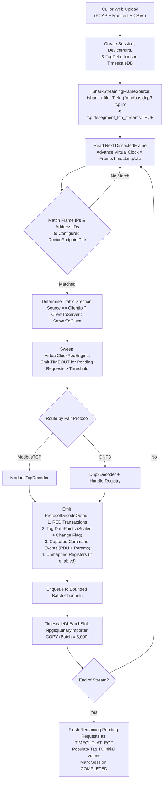
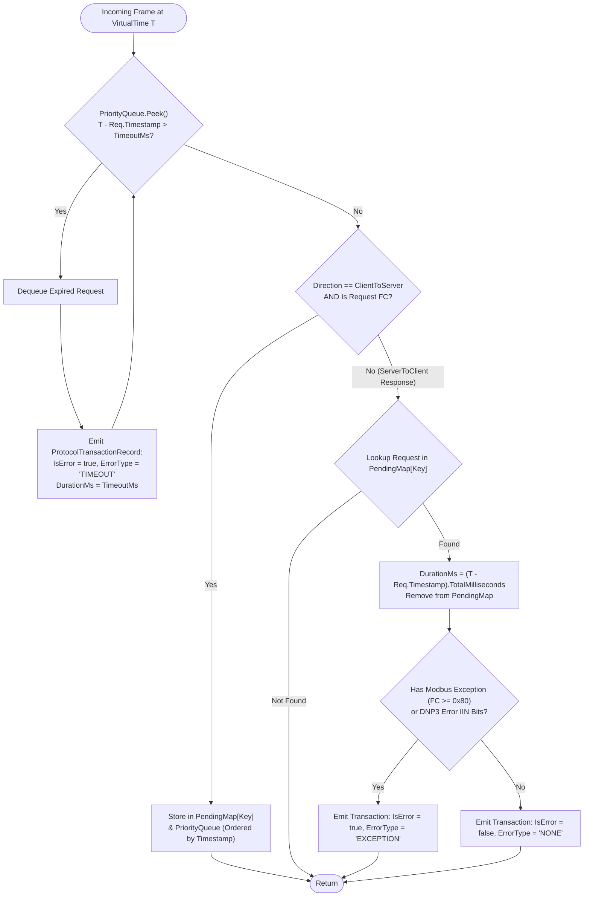
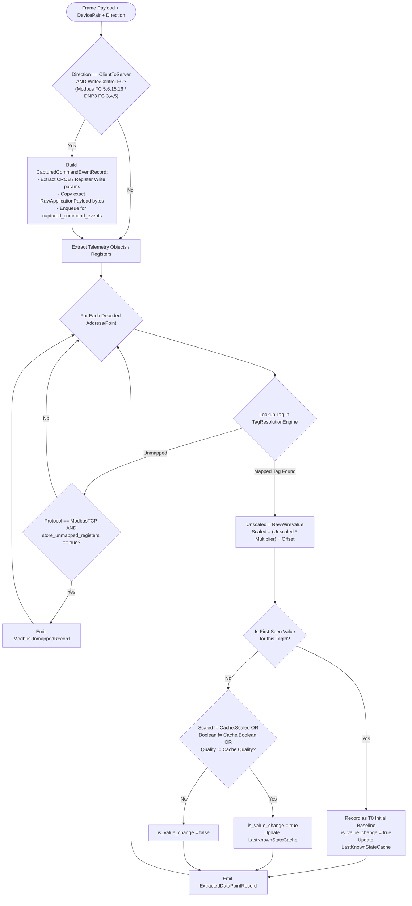

# MASTER ENGINEERING SPECIFICATION: Industrial Protocol Traffic Analyzer (FAT/SAT)

## 1. Project Purpose & High-Level Objectives
This application ingests Wireshark PCAP/PCAPNG captures of industrial network traffic (**Modbus TCP** and **DNP3**) to verify system performance during Factory Acceptance Testing (FAT) and Site Acceptance Testing (SAT).

### Core Capabilities
1. **PCAP Ingestion & Dissection:** Stream-process captures up to ~500 MB using a `tshark`-backed NDJSON streaming adapter with TCP stream desegmentation enabled.
2. **Protocol Decoding & Extensibility:**
   - **Modbus TCP:** Decode requests, responses, exceptions, and register payloads.
   - **DNP3:** Decode application headers, Internal Indications (IIN), and Object Groups/Variations using an extensible handler registry designed to scale to full **SEL RTAC** object support.
3. **Multi-Device Tag Resolution:** Map raw protocol addresses to human-readable engineering tags via CSV imports scoped to specific **Client/Server Device Pairs**, applying linear scaling ($y = mx + c$).
4. **Virtual-Clock RED Metrics:** Calculate Request **R**ate, **E**rrors (including configurable request timeouts and protocol exceptions), and **D**uration (response latency) using PCAP packet timestamps rather than wall-clock time.
5. **Time-Series & State Change Tracking:** Store both unscaled wire values and scaled engineering values, dual timestamps (PCAP arrival time vs. DNP3 internal RTU event time), quality flags, and state transition flags (`is_value_change`).
6. **Replay Readiness:** Capture frame sequencing, packet directionality, initial $T_0$ tag states, and raw/structured control commands (`captured_command_events`) so an adjacent Replay Service can perform either **Server Replay** (responding to external polls) or **Client Replay** (replaying captured control commands).
7. **Storage & Visualization:** Persist structured datasets in **TimescaleDB (PostgreSQL)** and archive raw PCAPs in **S3/MinIO**, enabling read-only analytics in **Grafana**.

---

## 2. Non-Negotiable Architectural & Coding Rules (For AI Agents)

1. **Priority Order:** Maintainability, Observability, Testability, and Extensibility take strict precedence over micro-optimizations.
2. **Clean / Hexagonal Architecture:**
   - `Analyzer.Core` must have **zero dependencies** on database drivers (`Npgsql`), external processes (`tshark`), or UI frameworks.
   - Protocol decoders must be pure, stateless/scoped domain services that accept dissected frames/byte payloads and emit strongly typed domain records.
3. **Unit Testability Without External Binaries:**
   - Unit tests must **never** invoke `tshark` or require a live database.
   - Ingestion is abstracted behind `IFrameSource`. Tests inject synthetic `DissectedFrame` streams or static NDJSON fixtures.
4. **Virtual Clock Enforcement:**
   - Never use `DateTime.Now` or `DateTime.UtcNow` when evaluating packet timeouts or transaction durations. All timing calculations must be driven exclusively by `DissectedFrame.TimestampUtc`.
5. **Cross-Platform Target:**
   - Target **.NET 8.0 (or .NET 9.0)** in C#. Code must compile and run identically on **Windows (`win-x64`)** and **Linux (`linux-x64`)**.
   - Must support deployment via **Docker Compose** and as a **Standalone Single-File Executable** (`PublishSingleFile=true`).
6. **Strong Domain Typing (Enums & Value Objects over Free-Form Primitives):**
   - Model finite sets of values (e.g., protocol identifiers, tag data types, error classifications, transaction status codes) using C# `enum` types or strongly typed value objects rather than free-form `string` or unconstrained primitive fields. Parse external strings into strong domain types at the ingestion/configuration seam and serialize to wire/database strings only at the persistence seam.

---

## 3. Solution & Directory Structure

```text
ProtocolAnalyzer/
├── GEMINI.md                                 # Master specification & agent instructions
├── docker-compose.yml                        # TimescaleDB, Grafana, MinIO, Analyzer.Web
├── sql/
│   └── 001_init_timescaledb.sql              # Complete DDL schema & helper functions
├── src/
│   ├── Analyzer.Core/                        # Pure Domain Models, Interfaces, Pipeline Orchestrator
│   │   ├── Domain/                           # Entities, Value Objects, Enums
│   │   ├── Interfaces/                       # IFrameSource, IProtocolDecoder, IDataSink, etc.
│   │   ├── Services/                         # VirtualClockRedEngine, TagResolutionEngine
│   │   └── Pipeline/                         # IngestionPipelineOrchestrator
│   ├── Analyzer.Decoders.Modbus/             # Modbus TCP Decoder & Register Extractors
│   ├── Analyzer.Decoders.Dnp3/               # DNP3 Decoder & SEL RTAC Handler Registry
│   │   ├── Handlers/                         # IDnp3ObjectGroupHandler implementations (G1, G2, G10, G12, G20, G22, G30, G32)
│   │   └── Registry/                         # Dnp3HandlerRegistry
│   ├── Analyzer.Infrastructure/              # External Adapters
│   │   ├── Dissection/                       # TSharkStreamingFrameSource (NDJSON parser)
│   │   ├── Persistence/                      # TimescaleDbBatchSink (NpgsqlBinaryImporter / Dapper)
│   │   ├── Mapping/                          # CsvTagMappingLoader & ManifestParser
│   │   └── Storage/                          # MinioPcapStorageService
│   ├── Analyzer.Cli/                         # CLI Tool (System.CommandLine)
│   └── Analyzer.Web/                         # ASP.NET Core Minimal API + Blazor Upload UI
└── tests/
    ├── Analyzer.Core.Tests/                  # Pipeline, Virtual Clock Timeout, Tag Scaling tests
    ├── Analyzer.Decoders.Modbus.Tests/       # Modbus FC decoding, exception, & unmapped tests
    ├── Analyzer.Decoders.Dnp3.Tests/         # DNP3 G/V handlers, dual-timestamp, CROB tests
    └── Analyzer.Infrastructure.Tests/        # CSV parser & NDJSON stream deserialization tests
```

---

## 4. Complete Database Schema (`sql/001_init_timescaledb.sql`)

Native TimescaleDB chunk compression is **intentionally disabled** by default to simplify operations and allow native `ON DELETE CASCADE` execution. A `delete_test_session` stored function is provided to future-proof chunk decompression before deletion.

```sql
CREATE EXTENSION IF NOT EXISTS timescaledb;

-- ============================================================================
-- 1. TEST SESSIONS (Parent Metadata Table)
-- ============================================================================
CREATE TABLE test_sessions (
    id UUID PRIMARY KEY DEFAULT gen_random_uuid(),
    name VARCHAR(255) NOT NULL,
    pcap_file_name VARCHAR(255) NOT NULL,
    s3_object_key VARCHAR(512),
    timeout_threshold_ms INT NOT NULL DEFAULT 2000,
    store_unmapped_registers BOOLEAN NOT NULL DEFAULT FALSE,
    ingested_at TIMESTAMPTZ NOT NULL DEFAULT NOW(),
    status VARCHAR(50) NOT NULL DEFAULT 'PROCESSING' -- 'PROCESSING', 'COMPLETED', 'FAILED'
);

-- ============================================================================
-- 2. DEVICE PAIRS (Strict Client/Server Semantics)
-- ============================================================================
CREATE TABLE device_pairs (
    id UUID PRIMARY KEY DEFAULT gen_random_uuid(),
    session_id UUID NOT NULL REFERENCES test_sessions(id) ON DELETE CASCADE,
    name VARCHAR(100) NOT NULL,
    protocol VARCHAR(50) NOT NULL,            -- 'ModbusTCP', 'DNP3'
    client_ip INET NOT NULL,
    server_ip INET NOT NULL,
    client_protocol_address_id INT,           -- e.g. DNP3 Master Address (nullable for Modbus)
    server_protocol_address_id INT            -- e.g. DNP3 Outstation Address or Modbus Unit ID
);
CREATE INDEX idx_device_pairs_session ON device_pairs(session_id);

-- ============================================================================
-- 3. TAG DEFINITIONS (Includes Scaling & T0 Initial State for Server Replay)
-- ============================================================================
CREATE TABLE tag_definitions (
    id UUID PRIMARY KEY DEFAULT gen_random_uuid(),
    device_pair_id UUID NOT NULL REFERENCES device_pairs(id) ON DELETE CASCADE,
    tag_name VARCHAR(255) NOT NULL,
    protocol_address VARCHAR(100) NOT NULL,   -- e.g. 'HR:40001', 'COIL:00012', 'G30V02:Idx4'
    data_type VARCHAR(50) NOT NULL,           -- 'BOOL', 'INT16', 'UINT16', 'INT32', 'FLOAT32_BE', 'FLOAT32_SWAPPED'
    scale_multiplier DOUBLE PRECISION NOT NULL DEFAULT 1.0,
    scale_offset DOUBLE PRECISION NOT NULL DEFAULT 0.0,
    engineering_units VARCHAR(50),
    description TEXT,
    -- Initial baseline state (T0) captured from first appearance in PCAP for Server Replay:
    initial_unscaled_numeric_value DOUBLE PRECISION,
    initial_scaled_numeric_value DOUBLE PRECISION,
    initial_boolean_value BOOLEAN,
    initial_raw_hex VARCHAR(64)
);
CREATE UNIQUE INDEX idx_tag_unique ON tag_definitions(device_pair_id, protocol_address);

-- ============================================================================
-- 4. RED TRANSACTIONS (Hypertable: Rate, Errors, Duration)
-- ============================================================================
CREATE TABLE red_transactions (
    timestamp TIMESTAMPTZ NOT NULL,
    session_id UUID NOT NULL REFERENCES test_sessions(id) ON DELETE CASCADE,
    device_pair_id UUID NOT NULL REFERENCES device_pairs(id) ON DELETE CASCADE,
    frame_number BIGINT NOT NULL,
    direction VARCHAR(20) NOT NULL,           -- 'CLIENT_TO_SERVER', 'SERVER_TO_CLIENT'
    transaction_id VARCHAR(50),               -- Modbus MBAP TxID or DNP3 App Sequence
    function_code SMALLINT,
    duration_ms DOUBLE PRECISION,             -- Response Timestamp - Request Timestamp
    is_error BOOLEAN NOT NULL DEFAULT FALSE,
    error_type VARCHAR(50) NOT NULL,          -- 'NONE', 'TIMEOUT', 'TIMEOUT_AT_EOF', 'EXCEPTION', 'MALFORMED'
    status_code VARCHAR(50) NOT NULL          -- 'SUCCESS', 'MODBUS_EX_02', 'DNP3_IIN_PARAM_ERR', etc.
);
SELECT create_hypertable('red_transactions', 'timestamp', chunk_time_interval => INTERVAL '1 day');
CREATE INDEX idx_red_session_cascade ON red_transactions(session_id, timestamp DESC);
CREATE INDEX idx_red_device_pair ON red_transactions(device_pair_id, timestamp DESC);

-- ============================================================================
-- 5. TAG VALUES / TIME SERIES (Hypertable: Dual Timestamps & Dual Numerics)
-- ============================================================================
CREATE TABLE tag_values (
    packet_timestamp TIMESTAMPTZ NOT NULL,
    event_timestamp TIMESTAMPTZ,              -- DNP3 internal RTU hardware timestamp (nullable)
    session_id UUID NOT NULL REFERENCES test_sessions(id) ON DELETE CASCADE,
    tag_id UUID NOT NULL REFERENCES tag_definitions(id) ON DELETE CASCADE,
    frame_number BIGINT NOT NULL,
    direction VARCHAR(20) NOT NULL,           -- 'CLIENT_TO_SERVER', 'SERVER_TO_CLIENT'
    unscaled_numeric_value DOUBLE PRECISION,  -- Wire value before scaling
    scaled_numeric_value DOUBLE PRECISION,    -- (unscaled * scale_multiplier) + scale_offset
    boolean_value BOOLEAN,
    raw_hex VARCHAR(64) NOT NULL,
    quality_flags VARCHAR(100),               -- e.g. 'ONLINE|RESTART|COMM_LOST'
    is_value_change BOOLEAN NOT NULL DEFAULT FALSE
);
SELECT create_hypertable('tag_values', 'packet_timestamp', chunk_time_interval => INTERVAL '1 day');
CREATE INDEX idx_tag_vals_session_cascade ON tag_values(session_id, packet_timestamp DESC);
CREATE INDEX idx_tag_vals_query ON tag_values(tag_id, packet_timestamp DESC);
CREATE INDEX idx_tag_vals_changes ON tag_values(tag_id, packet_timestamp DESC) WHERE is_value_change = TRUE;

-- ============================================================================
-- 6. CAPTURED COMMAND EVENTS (Hypertable for Client Control Replay)
-- ============================================================================
CREATE TABLE captured_command_events (
    timestamp TIMESTAMPTZ NOT NULL,
    session_id UUID NOT NULL REFERENCES test_sessions(id) ON DELETE CASCADE,
    device_pair_id UUID NOT NULL REFERENCES device_pairs(id) ON DELETE CASCADE,
    frame_number BIGINT NOT NULL,
    direction VARCHAR(20) NOT NULL DEFAULT 'CLIENT_TO_SERVER',
    protocol VARCHAR(50) NOT NULL,            -- 'ModbusTCP', 'DNP3'
    function_code SMALLINT NOT NULL,
    command_type VARCHAR(50) NOT NULL,        -- 'MODBUS_WRITE_SINGLE_COIL', 'MODBUS_WRITE_MULTI_REGS', 'DNP3_CROB_SELECT', 'DNP3_CROB_OPERATE', 'DNP3_DIRECT_OPERATE'
    target_address VARCHAR(100) NOT NULL,     -- e.g. 'HR:40005', 'G12V01:Idx2'
    control_action VARCHAR(50),               -- DNP3 CROB: 'PULSE_ON', 'PULSE_OFF', 'LATCH_ON', 'LATCH_OFF', 'TRIP', 'CLOSE'
    command_count SMALLINT,                   -- DNP3 CROB count or Modbus register count
    pulse_on_ms BIGINT,                       -- DNP3 CROB On-Time
    pulse_off_ms BIGINT,                      -- DNP3 CROB Off-Time
    unscaled_command_value DOUBLE PRECISION,  -- Written numeric value (if applicable)
    raw_pdu_bytes BYTEA NOT NULL              -- Exact Application PDU bytes for wire-accurate replay
);
SELECT create_hypertable('captured_command_events', 'timestamp', chunk_time_interval => INTERVAL '1 day');
CREATE INDEX idx_cmd_events_session_seq ON captured_command_events(session_id, frame_number ASC);

-- ============================================================================
-- 7. UNMAPPED MODBUS REGISTERS (Hypertable for Diagnostics & Contiguous Replay)
-- ============================================================================
CREATE TABLE modbus_raw_unmapped (
    timestamp TIMESTAMPTZ NOT NULL,
    session_id UUID NOT NULL REFERENCES test_sessions(id) ON DELETE CASCADE,
    device_pair_id UUID NOT NULL REFERENCES device_pairs(id) ON DELETE CASCADE,
    frame_number BIGINT NOT NULL,
    direction VARCHAR(20) NOT NULL,           -- 'CLIENT_TO_SERVER', 'SERVER_TO_CLIENT'
    unit_id SMALLINT NOT NULL,
    register_type VARCHAR(20) NOT NULL,       -- 'HOLDING', 'INPUT', 'COIL', 'DISCRETE_INPUT'
    register_offset INT NOT NULL,
    raw_value_hex VARCHAR(16) NOT NULL
);
SELECT create_hypertable('modbus_raw_unmapped', 'timestamp', chunk_time_interval => INTERVAL '1 day');
CREATE INDEX idx_modbus_unmapped_session ON modbus_raw_unmapped(session_id, timestamp DESC);

-- ============================================================================
-- 8. SESSION CLEANUP FUNCTION (Future Compression Hook)
-- ============================================================================
CREATE OR REPLACE FUNCTION delete_test_session(target_session_id UUID)
RETURNS VOID AS $$
DECLARE
    r RECORD;
BEGIN
    FOR r IN 
        SELECT DISTINCT chunk_schema, chunk_name 
        FROM timescaledb_information.chunks
        WHERE is_compressed = TRUE
    LOOP
        EXECUTE format('SELECT decompress_chunk(''%I.%I'', if_compressed => true);', r.chunk_schema, r.chunk_name);
    END LOOP;

    DELETE FROM test_sessions WHERE id = target_session_id;
END;
$$ LANGUAGE plpgsql;
```

---

## 5. Core C# Domain & Interface Contracts (`Analyzer.Core`)

Coding agents must implement these exact contracts in `Analyzer.Core`:

```csharp
namespace Analyzer.Core.Domain;

public enum TrafficDirection
{
    ClientToServer,
    ServerToClient
}

public enum ProtocolType
{
    ModbusTcp,
    Dnp3
}

public enum SessionStatus
{
    Processing,
    Completed,
    Failed
}

public enum TagDataType
{
    Bool,
    Int16,
    UInt16,
    Int32,
    Float32Be,
    Float32Swapped
}

public enum TransactionErrorType
{
    None,
    Timeout,
    TimeoutAtEof,
    Exception,
    Malformed
}

public enum TransactionStatusCode
{
    Success,
    Timeout,
    TimeoutAtEof,
    Malformed,
    ModbusEx01,
    ModbusEx02,
    ModbusEx03,
    ModbusEx04,
    ModbusEx05,
    ModbusEx06,
    ModbusEx08,
    ModbusEx0A,
    ModbusEx0B,
    ModbusExceptionUnknown,
    Dnp3IinFuncNotSupported,
    Dnp3IinObjectUnknown,
    Dnp3IinParamErr,
    Dnp3IinEventBufferOverflow,
    Dnp3IinAlreadyExecuting,
    Dnp3IinConfigCorrupt
}

[Flags]
public enum PointQualityFlags
{
    None = 0,
    Online = 1 << 0,
    Restart = 1 << 1,
    CommLost = 1 << 2,
    RemoteForced = 1 << 3,
    LocalForced = 1 << 4,
    ChatterFilter = 1 << 5,
    OverRange = 1 << 6,
    ReferenceErr = 1 << 7
}

public enum CommandType
{
    ModbusWriteSingleCoil,
    ModbusWriteSingleReg,
    ModbusWriteMultiCoils,
    ModbusWriteMultiRegs,
    Dnp3CrobSelect,
    Dnp3CrobOperate,
    Dnp3DirectOperate
}

public enum Dnp3ControlAction
{
    PulseOn,
    PulseOff,
    LatchOn,
    LatchOff,
    Trip,
    Close
}

public enum ModbusRegisterType
{
    Holding,
    Input,
    Coil,
    DiscreteInput
}

public readonly struct ProtocolAddress : IEquatable<ProtocolAddress>
{
    public string Value { get; }
    public ProtocolAddress(string value) { /* validates '<Prefix>:<Target>' format */ Value = value.Trim(); }
    public static ProtocolAddress Parse(string value) => new(value);
    public static bool TryParse(string? value, out ProtocolAddress result) { /* ... */ }
}

public record DeviceEndpointPair(
    Guid Id,
    Guid SessionId,
    string Name,
    ProtocolType Protocol,
    IPAddress ClientIp,
    IPAddress ServerIp,
    int? ClientProtocolAddressId,
    int? ServerProtocolAddressId
);

public record TagDefinition(
    Guid Id,
    Guid DevicePairId,
    string TagName,
    ProtocolAddress ProtocolAddress,
    TagDataType DataType,
    double ScaleMultiplier,
    double ScaleOffset,
    string? EngineeringUnits,
    string? Description
)
{
    public double ComputeScaledValue(double unscaledValue) => (unscaledValue * ScaleMultiplier) + ScaleOffset;
}

public record DissectedFrame(
    long FrameNumber,
    DateTime TimestampUtc,
    IPAddress SourceIp,
    int SourcePort,
    IPAddress DestIp,
    int DestPort,
    ProtocolType ProtocolName,
    byte[] RawApplicationPayload,
    IReadOnlyDictionary<string, string>? DissectedFields = null
);

public record ProtocolTransactionRecord(
    DateTime Timestamp,
    Guid SessionId,
    Guid DevicePairId,
    long FrameNumber,
    TrafficDirection Direction,
    string TransactionId,
    short FunctionCode,
    double? DurationMs,
    bool IsError,
    TransactionErrorType ErrorType,
    TransactionStatusCode StatusCode
);

public record ExtractedDataPointRecord(
    DateTime PacketTimestamp,
    DateTime? EventTimestamp,
    Guid SessionId,
    Guid TagId,
    long FrameNumber,
    TrafficDirection Direction,
    double? UnscaledNumericValue,
    double? ScaledNumericValue,
    bool? BooleanValue,
    string RawHex,
    PointQualityFlags QualityFlags,
    bool IsValueChange
);

public record CapturedCommandEventRecord(
    DateTime Timestamp,
    Guid SessionId,
    Guid DevicePairId,
    long FrameNumber,
    TrafficDirection Direction,
    ProtocolType Protocol,
    short FunctionCode,
    CommandType CommandType,
    ProtocolAddress TargetAddress,
    Dnp3ControlAction? ControlAction,
    short? CommandCount,
    long? PulseOnMs,
    long? PulseOffMs,
    double? UnscaledCommandValue,
    byte[] RawPduBytes
);

public record ModbusUnmappedRecord(
    DateTime Timestamp,
    Guid SessionId,
    Guid DevicePairId,
    long FrameNumber,
    TrafficDirection Direction,
    short UnitId,
    ModbusRegisterType RegisterType,
    int RegisterOffset,
    string RawValueHex
);

public record ProtocolDecodeOutput(
    IReadOnlyList<ProtocolTransactionRecord> Transactions,
    IReadOnlyList<ExtractedDataPointRecord> DataPoints,
    IReadOnlyList<CapturedCommandEventRecord> CommandEvents,
    IReadOnlyList<ModbusUnmappedRecord> UnmappedRegisters
);
```

### Core Service Interfaces

```csharp
namespace Analyzer.Core.Interfaces;

public interface IFrameSource
{
    IAsyncEnumerable<DissectedFrame> ReadFramesAsync(string pcapFilePath, CancellationToken ct = default);
}

public interface IProtocolDecoder
{
    ProtocolType Protocol { get; }
    ProtocolDecodeOutput ProcessFrame(
        DissectedFrame frame,
        DeviceEndpointPair pair,
        TrafficDirection direction);
    IReadOnlyList<ProtocolTransactionRecord> FlushExpiredTimeouts(DateTime currentVirtualTime, bool isEndOfFile);
}

public interface IDnp3ObjectGroupHandler
{
    ushort Group { get; }
    void ExtractObjects(
        DissectedFrame frame,
        DeviceEndpointPair pair,
        TrafficDirection direction,
        ushort variation,
        ReadOnlySpan<byte> objectData,
        ICollection<ExtractedDataPointRecord> dataPointsOut,
        ICollection<CapturedCommandEventRecord> commandsOut);
}

public interface IDataSink
{
    Task InitializeSessionAsync(TestSession session, IEnumerable<DeviceEndpointPair> pairs, IEnumerable<TagDefinition> tags, CancellationToken ct);
    Task WriteBatchAsync(ProtocolDecodeOutput batch, CancellationToken ct);
    Task UpdateTagInitialStatesAsync(Guid sessionId, CancellationToken ct);
    Task CompleteSessionAsync(Guid sessionId, SessionStatus status, CancellationToken ct);
}
```

---

## 6. Input Configuration & Tag Mapping Formats

### A. Session Manifest (`session_manifest.json`)
```json
{
  "session_name": "SAT_Substation_Feeder1",
  "pcap_file": "feeder1_capture.pcap",
  "timeout_threshold_ms": 1500,
  "store_unmapped_registers": false,
  "device_pairs": [
    {
      "name": "RTAC_Client_to_Relay_Server",
      "protocol": "ModbusTCP",
      "client_ip": "10.0.1.10",
      "server_ip": "10.0.1.20",
      "client_protocol_address_id": null,
      "server_protocol_address_id": 1,
      "tag_mapping_csv": "relay_modbus_tags.csv"
    },
    {
      "name": "SCADA_Master_to_RTAC_Outstation",
      "protocol": "DNP3",
      "client_ip": "10.0.1.5",
      "server_ip": "10.0.1.10",
      "client_protocol_address_id": 1,
      "server_protocol_address_id": 100,
      "tag_mapping_csv": "rtac_dnp3_tags.csv"
    }
  ]
}
```

### B. Tag Mapping CSV Format
```csv
Protocol,Address,TagName,DataType,ScaleMultiplier,ScaleOffset,Units,Description
ModbusTCP,HR:40001,Bus_Volts_A,FLOAT32_BE,0.1,0.0,kV,Phase A Bus Voltage
ModbusTCP,COIL:00005,Breaker_52A,BOOL,1.0,0.0,,Breaker Status
DNP3,G30V02:Idx0,Feeder_MW,INT16,0.01,0.0,MW,Active Power
DNP3,G01V02:Idx4,Relay_Trip_State,BOOL,1.0,0.0,,Protection Trip
DNP3,G12V01:Idx0,Breaker_Trip_Cmd,BOOL,1.0,0.0,,CROB Control Point
```

---

## 7. Subsystem Logic Flow Diagrams

### 7.1 End-to-End Ingestion & Persistence Flow


### 7.2 Virtual-Clock RED & Timeout Engine Logic


### 7.3 Protocol Decoding, Command Capture & Tag State Cache


---

## 8. DNP3 Object Group Handler Scope (Phase 1 vs. SEL RTAC Roadmap)

All DNP3 object parsing must implement `IDnp3ObjectGroupHandler` and register via Dependency Injection:

| Group | Variations | Description | Phase |
| :--- | :--- | :--- | :--- |
| **Group 1** | Var 1, 2 | Binary Input (Static) | **Phase 1 (Required)** |
| **Group 2** | Var 1, 2, 3 | Binary Input Event (With/Without Time) | **Phase 1 (Required)** |
| **Group 10** | Var 1, 2 | Binary Output Status | **Phase 1 (Required)** |
| **Group 12** | Var 1 | Control Relay Output Block (CROB) — *Also emits to `captured_command_events`* | **Phase 1 (Required)** |
| **Group 20** | Var 1, 2, 5, 6 | Running Counters (16/32-bit, with/without flag) | **Phase 1 (Required)** |
| **Group 22** | Var 1, 2, 5, 6 | Counter Change Events | **Phase 1 (Required)** |
| **Group 30** | Var 1, 2, 3, 4, 5 | Analog Input (Static: 16/32-bit Int & 32-bit Float) | **Phase 1 (Required)** |
| **Group 32** | Var 1, 2, 3, 4, 5, 7 | Analog Input Event (With & Without RTU Event Timestamp) | **Phase 1 (Required)** |
| **Group 21/23**| All | Frozen Counters & Events | *Phase 2 (SEL RTAC Roadmap)* |
| **Group 40/41**| All | Analog Output Status & Control Block | *Phase 2 (SEL RTAC Roadmap)* |
| **Group 50** | Var 1, 4 | Time and Date | *Phase 2 (SEL RTAC Roadmap)* |
| **Group 110/111**| All | Octet Strings | *Phase 2 (SEL RTAC Roadmap)* |

---

## 9. Implementation Plan for Coding Agents

Agents should execute this build in **6 sequential milestones**, running `dotnet test` at the completion of each milestone before advancing:

- **Milestone 1: Solution Scaffolding & Core Domain (`Analyzer.Core`)**
  - Initialize `.sln`, class libraries, and xUnit test projects.
  - Implement all domain records, interfaces, `VirtualClockRedEngine`, and `TagResolutionEngine` (with `LastKnownStateCache` and $T_0$ initial value capture).
  - Write unit tests verifying virtual-clock timeout expiration, request/response latency calculation, linear scaling math, and state-change detection.
- **Milestone 2: Modbus TCP Decoder (`Analyzer.Decoders.Modbus`)**
  - Implement MBAP header parsing, Function Codes `01, 02, 03, 04, 05, 06, 15, 16`, exception detection (`FC >= 0x80`), data type unpacking (`INT16`, `UINT16`, `FLOAT32_BE`, `FLOAT32_SWAPPED`, `BOOL`), command event extraction, and unmapped register capture.
  - Write unit tests using raw byte arrays for every Function Code and exception path.
- **Milestone 3: DNP3 Decoder & Handler Registry (`Analyzer.Decoders.Dnp3`)**
  - Implement Link/Transport/Application header parsing, sequence number tracking, IIN bit decoding, and `Dnp3HandlerRegistry`.
  - Implement Phase 1 Group Handlers (`G1, G2, G10, G12, G20, G22, G30, G32`), dual timestamp extraction (`packet_timestamp` + DNP3 48-bit `event_timestamp`), and CROB command capture.
  - Write unit tests for each Group/Variation handler.
- **Milestone 4: Infrastructure Adapters (`Analyzer.Infrastructure`)**
  - Implement `TSharkStreamingFrameSource` (reading `tshark -T ek` NDJSON output via `System.Text.Json`), `CsvTagMappingLoader`, and `TimescaleDbBatchSink` (using `NpgsqlBinaryImporter` for high-speed bulk inserts into hypertables).
  - Write unit tests for CSV loading and NDJSON parsing using static test fixtures.
- **Milestone 5: CLI & Web Entry Points (`Analyzer.Cli` & `Analyzer.Web`)**
  - Build the CLI (`analyze --manifest <path> --db <conn_string>`).
  - Build the Web UI / API for drag-and-drop PCAP + CSV uploads and session management.
- **Milestone 6: Containerization & Standalone Packaging**
  - Author `Dockerfile` (including `tshark` installation) and `docker-compose.yml` (`timescaledb`, `grafana`, `minio`, `analyzer-web`).
  - Configure single-file publish profiles for Windows and Linux standalone execution.